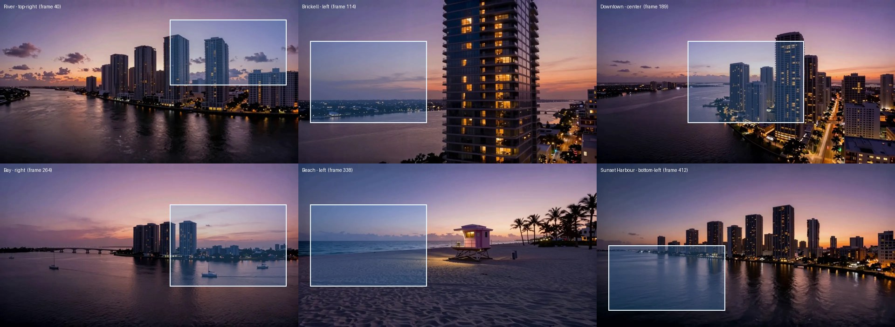

# Flight v3: a dusk flight shot for the light path landing

Date: 2026-10-15 · Branch: `feat/flight-v3` (from `feat/survey-landing`) · Status: design approved in conversation, spec awaiting review

## Why

The Cinematic landing (`src/landing/`, spec `2026-10-14-light-path-landing-design.md`) places six text points on the six flight stops, but the current film (`flight_v2`) was composed for an older layout with an info card on the left. Three stops put buildings right behind their text (River, Downtown, Bay). The light path should also pass behind buildings while the camera flies, not only at the stops. And wide, high-density screens deserve frames sharper than 1280 wide.

## Goals

1. A new Miami dusk flight whose six stops each leave calm sky or water behind their text, with the landmark on the opposite side.
2. An HD frame set (1920×1056) alongside the desktop (1280×704) and phone (420×704) sets.
3. A per-frame occlusion matte (buildings and foreground; sky and water excluded) aligned pixel for pixel with every frame of every set, so the light path passes behind buildings during holds and in flight.
4. Frame count and stop indices unchanged: 413 frames, stops at 40, 114, 189, 264, 338, 412.

## Owner's non-negotiables

- Dusk light that only moves forward: afterglow, then twilight, then blue hour.
- The camera flies between the Brickell towers.
- Clean buildings: no melting, smearing or scratchy textures.
- The flight ends at Sunset Harbour.
- Best quality available on the local RTX 4080 (16 GB).
- The site keeps the "AI-rendered flight · not real footage" disclosure (LTX license).

## What the layout requires of the film

Text scrolls while the film holds: each point's section is at least 110svh and its text block (up to 560px, on a 12-column grid with a `clamp(16px, 4vw, 56px)` gutter) moves across the screen during the hold. So the calm area for a stop is a **full-height column** on the text's side, not a box. River (first screen, top-right) and Sunset Harbour (last, bottom-left) are corner zones. Between 768px and about 1100px the center point moves to columns 1–9, so Downtown's text sits further left on tablets and relies on its existing dark backing there.

## Shot list (agreed)

| Stop | Frame | Text | Hold composition | Light |
|---|---|---|---|---|
| River | 40 | top-right | Looking down the Miami River; towers on the **left** bank, dark water across the bottom, open violet sky top-right. Afterglow kept low on the horizon so the sky behind the name is the deeper violet. Also the poster frame. | afterglow |
| Brickell | 114 | left | One tall tower close on the **right**, open sky and bay on the left (current framing, re-rendered). | late afterglow |
| Downtown | 189 | center | **Corridor**: the camera hovers over the river between downtown towers; towers fill the outer thirds on both sides, open sky and water run up the middle. | twilight |
| Bay | 264 | right | Residential towers and the lit causeway on the **left**, a few sailboats near them; open water and pink-violet sky fill the right column top to bottom. | pink-violet twilight |
| Beach | 338 | left | Current framing: lifeguard tower and palms on the right, ocean and sky on the left. Re-rendered. | blue hour, faint peach line |
| Sunset Harbour | 412 | bottom-left | Current framing: skyline across the bay, calm water bottom-left. Re-rendered. | deep blue hour, thin ember line |

Hops:

1. **River → Brickell**: crosses the river and turns right toward the Brickell tower.
2. **Brickell → Downtown**: banks left and **threads the gap between two Brickell towers**, then emerges over the river into the Downtown corridor. The tight move happens with no text on screen; the matte lets the light slip behind both towers.
3. **Downtown → Bay**: rises out of the corridor's far end, out over the bay, swinging so the towers end up on the left.
4. **Bay → Beach**: low across the water toward the beach.
5. **Beach → Sunset Harbour**: rises over palms and rooftops toward the skyline across the bay.

Prompt rule kept from v2: no sun disk, flare or orange sky over the ocean after the first stop, and never the words "sun" or "sunset" in a prompt.

## Section 1: Film and timing

- Master: ~826 frames assembled as in v2 (`assemble_v2.py` pattern: reverse pull-back arrivals so each stop lands exactly on its still, forward departures, joins at peak motion with a radial blur and colour match, speed ramp). The site takes every second frame, giving 413.
- Stops: four Z-Image seeds per stop, picked on a contact sheet that draws each stop's real text zone (full-height column or corner box). The film freezes on the stop frame while the text is up, as now.
- Clean buildings: each hop is reviewed on a contact sheet. Melting or scratchy sections are re-rolled with a new seed or healed frame by frame with Z-Image. Nothing ships with a known artifact.
- New files: `tools/flight/stops_v3.json` (prompts, seeds, pull-back overrides) and updated `pins.json` (landmark positions for the phone crop and labels). The v2 files stay for reference.

## Section 2: Pipeline and outputs

Chain: LTX-2.5 hops at 1280×704 → `flight_v3.mp4` → SeedVR2 3B upscale to 1920×1056 as a lossless PNG sequence (the **HD master**) → every frame set and every matte is cut from that one master, so all sets line up exactly.

| Output | Size | Notes |
|---|---|---|
| `public/flight/hd/fNNN.webp` | 1920×1056 | new |
| `public/flight/desktop/fNNN.webp` | 1280×704 | scaled down from HD (sharper than today) |
| `public/flight/phone/fNNN.webp` | 420×704 | same landmark-following crop as now, from the desktop-scale image |
| `public/flight/matte/wide/fNNN.webp` | 960×528 | alpha-only WebP, used by HD and desktop |
| `public/flight/matte/phone/fNNN.webp` | 315×528 | same crop offsets as the phone frames, at matte scale |

Matte:

- Model: SegFormer-B5 fine-tuned on ADE20K (`nvidia/segformer-b5-finetuned-ade-640-640`), safetensors only, pinned to a commit hash.
- Run on each HD frame; keep the per-pixel class probabilities (not hard labels) for softer, truer edges.
- matte = P(upright occluders): building, skyscraper, house, tower, tree, palm, pole, bridge, streetlight, boat, ship, column, fence, railing, booth, canopy, awning, tent, signboard. *Changed 2026-10-17:* the first rule, 1 − P(sky + water + sea + river + lake), also counted sand, shoreline and roads as foreground (51% of the Beach text zone), which would hide the light over flat ground. Sky, water and ground now all stay clear.
- Temporal smoothing: each frame's matte is averaged with its neighbours at weights 0.25 / 0.5 / 0.25 (at the 413-frame rate), to stop flicker in flight. Stop frames use their own matte unsmoothed, so a held matte never ghosts a neighbouring frame.
- Specks smaller than 0.1% of the frame are removed; then a 1px feather.
- Expected size: about 5–15 KB per matte.

Scripts in `tools/flight/` (each listed in the README table):

- `upscale_hd.py`: runs SeedVR2 through the ComfyUI API on `flight_v3.mp4`, writes the HD master.
- `matte.py`: runs SegFormer, smooths, writes the matte sequence at master resolution.
- `export_site.py`: extended to read the HD master and mattes, write all five sets above, and regenerate `src/flight/flightData.ts` with `hdWidth`, `hdHeight`, `matteWidth`, `matteHeight`, `phoneMatteWidth`.

Environment and safety:

- **Change from the conversation:** we agreed a separate `matte-venv`. Since then, another session's `occluders.py` (commit `7c60248`) already uses `transformers` 5.17 and `torch` 2.14+cu130 in ComfyUI's embedded Python. The spec therefore reuses that Python (run with `-I`) and skips the ~2.5 GB torch download. If you'd rather keep ComfyUI's packages untouched by new models, fall back to the separate venv.
- The only new download is the SegFormer-B5 weights (~330 MB). Claude asks before downloading it.
- Approximate totals, measured for real after export: HD 45–55 MB, desktop 20–25 MB, mattes ~4 MB.

## Section 3: Landing integration

Frame set choice (a pure function, `pickSet`):

| Condition | Set |
|---|---|
| width < 768px | `phone` |
| width ≥ 1440px, or width ≥ 960px with a device pixel ratio of 1.5 or more | `hd` |
| browser's data saver on (`navigator.connection.saveData`) | never `hd` |
| everything else | `desktop` |

The set switches only when a media query's result changes, as now.

Occlusion layer:

- A second fixed canvas, `film__front`, replaces the stop-only `.film-occluders` / `.film__occluder` images from commit `7c60248`. It sits in the same place in the stack (above the light path at z-index 1, below the text): film → light path → `film__front` → text.
- On each paint it draws the current frame, then cuts it to that frame's matte (`destination-in`), with the same `coverDraw` rectangle as the film canvas. So the light disappears behind real building pixels of the very same frame.
- The dusk haze is drawn into `film__front` too (the same two gradients as `.film::after`, composited `source-atop`), so foreground buildings match the hazed film underneath and show no brighter edge.
- Camera sway: `film__front` joins the film's sway selector (`.film__canvas, .film__poster, .film__front`) and gets the same `scale: 1.04`, so it moves with the film.

Loading:

- Mattes load through a second `FrameStore` using the same frame numbers and playhead.
- A frame is only ever drawn with **its own** matte. If that matte has not arrived, `film__front` is cleared for that frame and the light shows on top. That's harmless, while a mismatched matte would show visible ghosting.

Other behaviour:

- Nodes: at each stop the node sits in the calm text zone, so it stays visible. In flight, the bright head can pass behind a tower, which is the effect asked for.
- Reduced motion or motion off: one still per point, as now, drawn with that still's matte, so the full path passes behind buildings there too.
- Unchanged: the poster image (no front layer until the first canvas paint), the text's dark backing, the AI disclosure, the device-pixel-ratio cap of 2.

Retired:

- `tools/flight/occluders.py`, `public/flight/occluders/`, `heldStop`'s cut-out toggling in `Film.tsx`, the `.film-occluders` CSS, and `occluder.test.tsx`. Each is replaced by its per-frame equivalent above, and the replacement tests cover the same behaviour.
- Removed in the same PR that adds `film__front`, so the light never loses occlusion in between.

## Section 4: Checks, review stops and delivery

Review stops (the owner approves before work continues):

1. Contact sheet of stop stills with the text zones drawn: the owner picks one per stop.
2. Contact sheet for each hop: approve, or re-roll.
3. Full preview video of `flight_v3` before export.
4. Matte preview video (buildings tinted, sky and water clear) before any landing code changes.

Automatic checks in `export_site.py`, which fails the export if any break:

- 413 frames in every set (hd, desktop, phone, matte/wide, matte/phone).
- Stops at 40, 114, 189, 264, 338, 412.
- Frame and matte dimensions as specified; frame and matte counts match one for one.
- At each stop, matte coverage inside that stop's text zone is under 15%. *Changed 2026-10-17 (owner's call):* the first limit was 2%, but a full-height text column always crosses the horizon. The rendered stops measure River 0.02%, Brickell 9.29% (far shoreline lights), Downtown 13.08% (bridge and two small towers at the vanishing point), Bay 1.97%, Beach 0.00%, Sunset Harbour 7.58% (the skyline's left edge in the zone's top-right corner). All of that is distant and low-detail; the text's dark backing covers it. 15% still refuses a tower standing behind the text.
- The upper sky band (top 15% of the frame, outside buildings) never brightens from one stop to the next: light only moves forward.

Unit tests (Vitest):

- `pickSet` for each viewport, density and data-saver case.
- Each frame is drawn only with its own matte, and `film__front` is cleared when that matte is missing.
- The shape of `flightData.ts` (new fields present; stop frames unchanged).
- The existing poster test stays green.

Browser checks (built-in preview):

- Screenshots at all six stops on desktop, HD and phone widths.
- The light passing behind the towers during the Brickell → Downtown hop.
- Reduced motion.
- No console errors.
- Network sizes recorded in the PR.

Delivery:

- Branch `feat/flight-v3` from `feat/survey-landing`. A draft PR opens against `feat/survey-landing`, then is retargeted to `main` once `garciabel212/About-Me#14` merges. Squash merge; never a push to `main`.
- Commits in order:
  1. this spec
  2. tools and stops data
  3. the frame sets and mattes
  4. landing integration with retirement of the stop-only occluders
  5. README and docs
- Binary assets (~75 MB of WebP) go in git as the current frames do; no single file is near GitHub's 100 MB limit.

## Out of scope

The Read page, copy changes, new stops or a different stop count, and changes to the light path's curve.

## Risks

- **LTX may not hold the corridor or the tower gap cleanly.** Mitigation: pull-back arrivals from a chosen still, extra seeds, and Z-Image healing; if the gap won't render cleanly, fall back to banking tightly past one tower and tell the owner.
- **SegFormer may label glass towers reflecting sky as sky.** Mitigation: the matte preview review step; per-hop morphology close; as a last resort, use Depth Anything V2 Small (already cached) as a tie-breaker for pixels whose sky probability sits between 0.35 and 0.65.
- **SeedVR2 may shimmer on fine building detail.** Mitigation: check a 3-second sample on the hardest hop (Brickell → Downtown) before upscaling everything.
